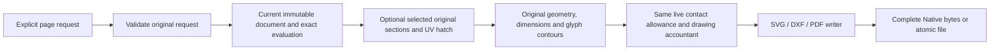

# Drawing Page Publication

## Purpose and Scope

This component composes current original drawing geometry into Native page bytes
or one atomic file. Parent: [RupaAutomation](../DESIGN.md). It extends only the
legacy read-only drawing command lane, independently of prepared source programs.
Children: none.

## Responsibilities and Boundaries

The caller owns explicit paper dimensions, model-to-paper law, font and allowed
fallback names, dimension placement, contact tolerance and all resource ceilings.
This component validates that configuration and invokes the existing original page,
selected-section, hatch, glyph-boundary and format producers. It owns no document
mutation, save, source-group transaction, renderer, or approximation authority.

## Related Designs

| Design | Relationship | Contract Used | Summary | Cautions |
|---|---|---|---|---|
| [Automation](../DESIGN.md) | parent | command dispatch and result | Current session read-only publication. | Prepared source programs remain separate. |
| [SwiftCAD](/Users/1amageek/.codex/worktrees/occt-parity/swift-CAD/Sources/SwiftCAD/DESIGN.md) | depends on | actual Kernel/Exchange types and atomic format writer | Direct Automation target dependency owns Native page publication. | No alias or display approximation replaces original geometry. |
| [Drawing pages](../../RupaCore/DrawingGeometry/DrawingPages/DESIGN.md) | depends on | original page composition | One original SI-to-paper map. | Angular source and bounded lower failures propagate. |
| [Drawing glyphs](../../RupaCore/DrawingGeometry/DrawingGlyphs/DESIGN.md) | depends on | live contact issuer and exact nonzero boundary | Uses explicitly requested registered Native fonts. | A non-outline glyph is a failure; no bitmap substitution. |

## Architecture

## Contracts and Invariants

All page lengths are paper points. Curve and glyph deviation are explicit paper
point allowances; paper contact tolerance is also in paper coordinates. SI geometry
is mapped once by `DrawingGeometricPageOptions`. Existing line styles are physical
paper point styles, without a preset, normalized fallback, fitted scale or guessed
font. Native decoding does not publish geometry: execution reconstructs and validates
options before use. Section/hatch policy is optional and explicit; asking for it
requires the actual original support and solid classifier route, never mesh sections.
One DrawingExchangeUsage and one glyph contact issuer are retained across preparation,
page composition and serialization. Lower residual receipts reduce the same owner
before another phase begins; no fresh caller budget is introduced. The geometric,
source and algebra depth limits remain independent.

Result metadata is measured from the actual composed page. Bytes are returned only
after the writer completes. File publication is delegated to the existing atomic
writer. A generation and saved view identify the invocation; they are not a fabricated
geometric proof or a substitute for retained original source validation.

## Runtime Flows

Validate configuration -> capture current source -> prepare optional sections/hatch
-> compose current original page -> resolve glyph boundaries -> write -> return.
Failure at any stage returns no page result. An atomic file failure leaves the
previous destination intact according to the Exchange publisher contract.

## State, Ownership, and Lifecycle

The session is read synchronously; it is not retained after publication. The live
accountant and glyph issuer belong to this invocation. The byte sink protects its
owned Data with a Mutex and pre-admits output capacity before append. The completed
Data snapshot shares immutable COW storage only at the publication boundary.

## Failure, Concurrency, and Constraints

Unsupported format, invalid style/font/layout, unresolved original source, exceeded
work/storage/cell/depth/deadline, cancellation and lower incomplete proof fail
explicitly. No partial bytes, incomplete glyph outline, arbitrary section omission
or a successful empty placeholder is returned. Full lower SSI/UV arrangement and
selected algebra/endpoint localization gaps remain marked in their callable paths.

## Verification and Change Impact

Deferred until SOURCE87 is stable: execute both command cases with explicit styles,
font fallback and overlapping nonzero contours; inspect actual format output and
atomic late-failure preservation; verify dimension/section/hatch source provenance,
foreign live issuer rejection, lowered work/bytes/depth limits and cancellation.
Changes affect command/result Native codecs, agent catalog integration, page and
Exchange contracts. Source authorship alone is not behavior, review or main evidence.

An optional explicit DrawingSilhouettePolicy requests original placed contour
publication. It supplies body closure, aggregate face/span and local source/cell
capacities; the page's existing resources supply bytes/work and three independent
depth capabilities. A DrawingSilhouetteAdmission binds extraction and paper paths
to the same live Exchange owner. This policy does not request or fabricate
visible/hidden classification. Required contact/whole-zero source categories
must be preserved by the immutable page or fail before publication.

Requested silhouettes create one explicit DrawingSilhouettePreparation and route
through the contour-bearing page overload before the real format writer. Precision
is caller-native maximumParameterWidth. Point-event provenance and full visibility
remain explicit lower gates, not successful omission.
